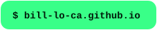
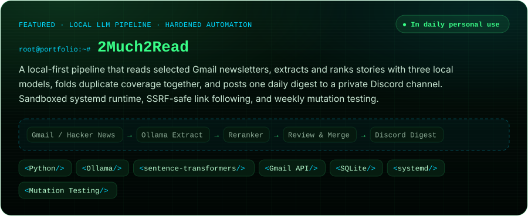
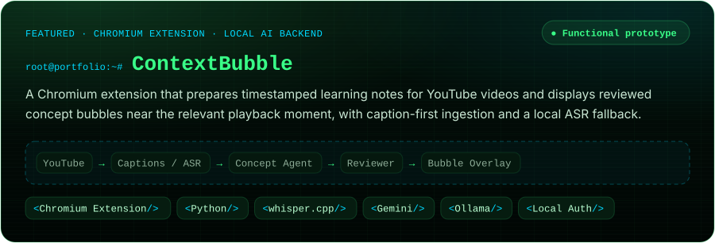
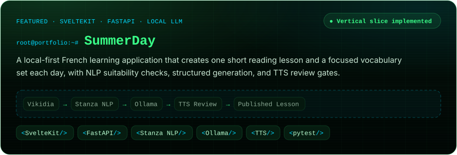
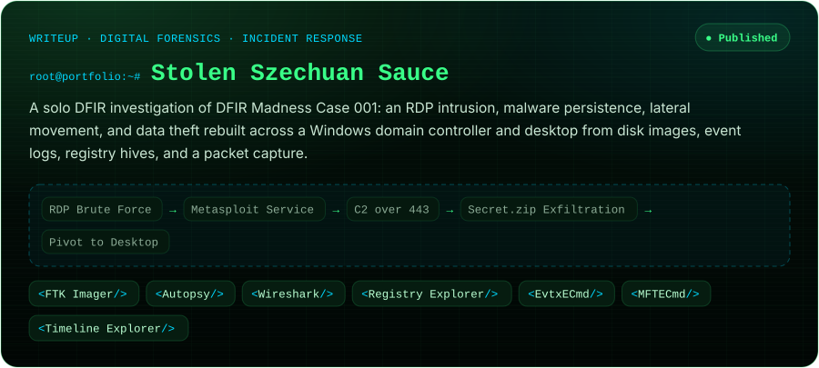

<!-- The images in assets/ are generated by tools/generate_assets.py (run: python tools/generate_assets.py assets). Edit the text there, not in the SVGs. -->

  
  
  
  

### `$ ls ~/projects`

[Project page](https://bill-lo-ca.github.io/projects/2much2read/) · [Repository](https://github.com/Bill-Lo-CA/2Much2Read)

### `$ cat ~/writeups`

- [Building a SIEM-Based Incident Response Lab](https://medium.com/@lagane100/building-a-siem-based-incident-response-lab-with-splunk-snort-kali-linux-and-windows-server-720a20f44620) — Splunk, Snort, Kali Linux and Windows Server
- [Hack The Box profile](https://app.hackthebox.com/public/users/3095335) — ongoing hands-on security practice

### `$ cat skills.md`

### `$ cat education.txt`

Post-graduate certificates in Cybersecurity (Dean's Honour List) and Artificial Intelligence, Algonquin College · B.Sc. in Computer Science
